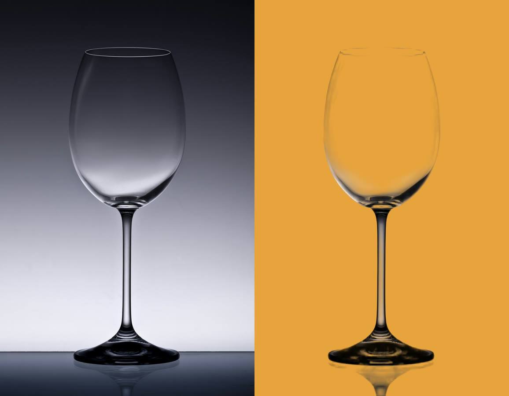
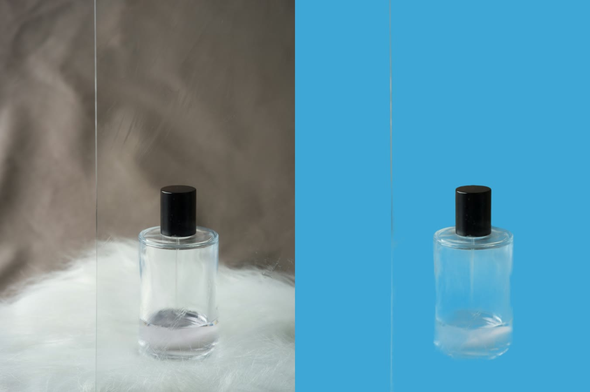
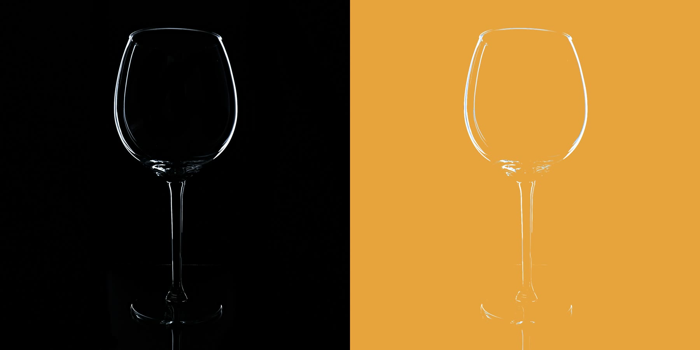

# Cut out glass and keep it see-through (free, on your own computer)

Most background removers turn glass solid: they cut out the shape, but the old background stays *inside* the bottle, so it looks wrong on a new background. We tested every model in [rembg](https://github.com/danielgatis/rembg) on wine glasses and perfume bottles, and they all did that.

What works is **BiRefNet-matting** by Peng Zheng et al. (MIT): instead of a cut-out, it predicts how see-through every pixel is. [`glass.py`](glass.py) wraps it into one command.

| Original → `glass.py` | |
| --- | --- |
|  | Wine glass on a grey gradient → see-through on orange (`glass.py`, default) |
|  | Clear bottle on white fur → the fur is gone, blue shows through the glass |
|  | Glass on pure black → `--black`, no AI, under a second |

Photos: [Honza Vojtek](https://unsplash.com/photos/UtByU3uhBVM), [Kier in Sight Archives](https://unsplash.com/photos/j1vg92xdoX4), [Michael Oeser](https://unsplash.com/photos/PCxvRoNoi6w) on Unsplash (Unsplash License).

> 🤖 **Don't want to install it yourself?** Paste [PROMPT.md](PROMPT.md) into Claude Code, Codex or Gemini CLI. The agent shows you what it will install, sets it up in one folder, and removes everything when you're done.

> 🎙️ The voiceover in our videos is made with [ElevenLabs](https://try.elevenlabs.io/s3p4rzmexcmc). Affiliate link: we earn a commission if you subscribe, at no extra cost to you.

- Model: [BiRefNet-matting](https://huggingface.co/ZhengPeng7/BiRefNet-matting) (MIT, OK for commercial use)
- Script: [`glass.py`](glass.py) (CC0, ours)

## Install

You need about **2 GB of disk** (PyTorch ~1.2 GB + the model ~880 MB, downloaded on first run) and **at least 9 GB of RAM** (peak memory in our tests).

> ✅ **macOS:** tested by us on a MacBook Air M4.
> 📄 **Windows and Linux:** not tested by us. These commands are taken from the official documentation: [uv installation](https://docs.astral.sh/uv/getting-started/installation/), [uv: running scripts](https://docs.astral.sh/uv/guides/scripts/), [PyTorch install](https://pytorch.org/get-started/locally/), [Python venv](https://docs.python.org/3/library/venv.html).

**The easy way (macOS, Windows, Linux): uv.** [uv](https://docs.astral.sh/uv/) reads the list of packages at the top of `glass.py` and installs them for you, together with the right Python. No virtual environment to create or activate.

1. **Install uv** (skip it if `uv --version` already works):

   | System | Command |
   | --- | --- |
   | macOS | `brew install uv` (no Homebrew? use the Linux command) |
   | Linux (from the uv docs) | `curl -LsSf https://astral.sh/uv/install.sh \| sh` |
   | Windows, PowerShell (from the uv docs) | `winget install --id=astral-sh.uv -e` or `powershell -ExecutionPolicy ByPass -c "irm https://astral.sh/uv/install.ps1 \| iex"` |

   Then close the terminal and open a new one.
2. **Download [`glass.py`](glass.py)** (the ⬇ *Download raw file* button) into the folder with your photos.
3. **Run it:**

   ```bash
   uv run glass.py bottle.jpg
   ```

   The first run takes a few minutes while uv installs PyTorch and the model downloads. After that it starts right away.

**NVIDIA graphics card?** On Linux, the default PyTorch already supports NVIDIA GPUs. It's a bigger download, several GB more. If you don't have an NVIDIA card, use the CPU build in the pip version below, it's much smaller. On Windows, the default PyTorch is CPU-only. For your GPU, follow the pip version below and get the install command from [pytorch.org](https://pytorch.org/get-started/locally/) (pick *Pip* and your CUDA version).

**Prefer pip?** You need Python 3.10–3.13:

| System | Create and activate an environment |
| --- | --- |
| macOS / Linux | `python3 -m venv glass-env && source glass-env/bin/activate` |
| Windows, PowerShell (from the Python docs) | `py -3.12 -m venv glass-env; glass-env\Scripts\Activate.ps1` |

```bash
pip install torch torchvision --index-url https://download.pytorch.org/whl/cpu   # Linux/Windows without NVIDIA (skip on macOS)
pip install torch torchvision transformers timm kornia einops opencv-python-headless pillow
```

Then run `python glass.py …` instead of `uv run glass.py …`. On Windows, if PowerShell won't run `Activate.ps1`, run `Set-ExecutionPolicy -Scope CurrentUser RemoteSigned` once.

The model's code is loaded from the author's Hugging Face repo (`trust_remote_code`), the same way the official BiRefNet demo does it.

**Remove it later:** `uv cache clean` (or delete the `glass-env` folder), then delete the model from the Hugging Face cache: the `models--ZhengPeng7--BiRefNet-matting` folder in `.cache/huggingface/hub` in your home folder.


## Use it

The same on every system (with pip, write `python` instead of `uv run`):

```bash
uv run glass.py bottle.jpg                    # → bottle.png (transparent)
uv run glass.py photos/ -o cutouts/           # every photo in a folder
uv run glass.py wineglass.jpg --black         # glass shot on pure black: no AI needed
uv run glass.py bottle.jpg --model hr         # finer edges, needs ~11 GB RAM, much slower
uv run glass.py mug.jpg --model general       # plain cut-out for solid objects
```

It uses your GPU automatically: NVIDIA (CUDA), Apple Silicon (MPS), otherwise the CPU.

| Option | What it does |
| --- | --- |
| `--model matting` | default: transparency for glass, clear plastic, veils, hair |
| `--model hr` | high-resolution matting (2048 px). Finer edges, but 8–11 GB RAM and minutes per photo on a laptop |
| `--model general` | regular BiRefNet cut-out: sharper and more saturated on solid objects |
| `--black` | for glass shot on pure black: brightness becomes transparency. Instant, no model download |
| `--floor 20` | `--black` only: anything darker counts as background. Raise it if you see a faint box (the table) under the glass |
| `--clean 0.10` | AI only: removes faint grey smudges in the background. Set `0` to keep every soft pixel |

## How fast (MacBook Air M4, 16 GB, photos 1600 px)

| Setup | Per photo |
| --- | --- |
| Apple GPU (MPS), model downloaded | ~6 s (+ ~6 s to load the model once per run) |
| CPU only | ~13 s |
| First run ever | + model download (~880 MB) |
| `--black` | < 1 s |

Process a folder in one run: the model loads only once.

## What works and what doesn't

- ✅ Wine glass on a grey gradient, clear bottle on white fur: properly see-through.
- ✅ Glass on pure black: use `--black`, it beats the AI.
- ⚠️ Solid, coloured bottles (frosted, faceted, tinted): `matting` can make them look washed out. Use `--model general` or [rembg](../removebg-alternative/) instead.
- ❌ A bottle on a dark, **wet** surface came out smeared. Shoot glass on a plain, light background.
- No luck with your photo? Try the official [BiRefNet demo](https://huggingface.co/spaces/ZhengPeng7/BiRefNet_demo) (choose *Matting*). It runs in the browser, but your photo is uploaded.

## Related

- [removebg-alternative](../removebg-alternative/): rembg for everyday photos, hair and fur, plus the license catch in its default model.

---

From the Explainbrew videos about removing backgrounds. Tested October 30, 2026. Not affiliated with BiRefNet, rembg or remove.bg. Test photos from [Unsplash](https://unsplash.com): Honza Vojtek, Kier in Sight Archives, Michael Oeser, Lana Graves.

**Use at your own risk:** provided as is, with no warranty. See the [disclaimer](../README.md#disclaimer-use-at-your-own-risk).
